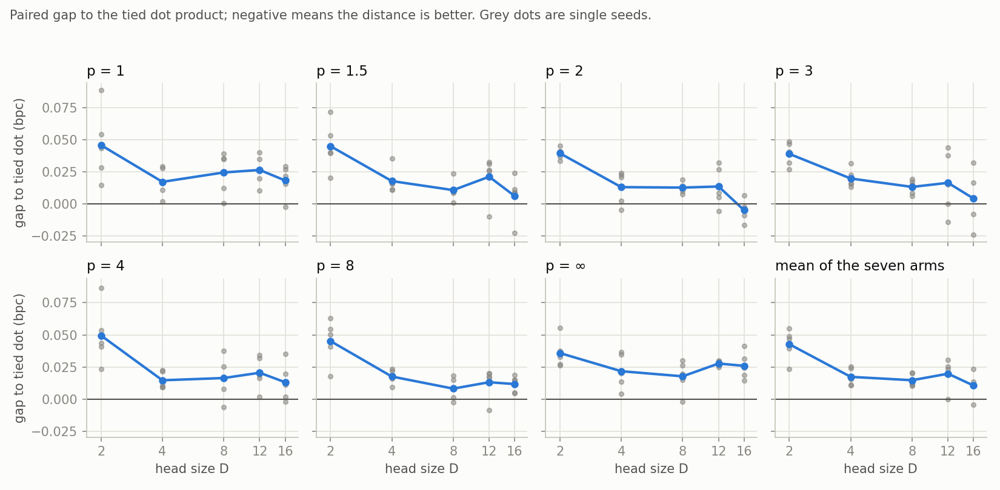

# Can a distance replace the dot product in attention?

### 📄 [**Read the paper: Distance attention at small head sizes for a character-level language model (PDF)**](paper/main.pdf)

Self-attention scores a query against a key with a dot product.
We swapped it for a negative $\ell^p$ distance, tried seven exponents $p$ and five head sizes $D$, and trained **235 small language models** to see what happens.

**The short answer: the dot product wins, and by the most where we expected it to lose.**



*Each panel is one exponent $p$. Points above zero mean the dot product is better. Grey dots are single seeds.*

## What we found

- **The dot product is better in 34 of 35 cells.** The one exception is $p=2$ at $D=16$, by 0.005 bits per character, which is within noise.
- **The distance penalty is largest for the smallest heads.** We conjectured that distances cope better when the query-key space is crowded. The data point the other way.
- **The exponent barely matters.** All 45 crossed cells land within a range of about 0.07 bits per character, against 2.93 for uniform attention.
- **Distances learn faster at first.** They lead the dot product at step 500 in 33 of 35 cells, then fall behind from about step 1,000.
- **They also cost more.** Distance runs take 1.3 to 5.8 times as long as dot-product runs in our implementation.

## Why this might interest you

- It is a clean, fully paired comparison: same seeds, same data, a calibrated score scale and a learning-rate scan for every cell.
- It is a negative result with the whole experiment attached, including the full run logs, the final weights and an independent recomputation of the tests.
- The paper includes the geometry behind the idea: dot-product scores can only favour keys on the edge of the key cloud, while a distance can favour any key.

## Setup in one paragraph

A two-layer, character-level transformer trained for 4,000 steps on Tiny Shakespeare.
Nine score rules: the tied dot product, seven $\ell^p$ distances ($p \in \{1, 1.5, 2, 3, 4, 8, \infty\}$) and the untied dot product.
Head sizes $D \in \{2, 4, 8, 12, 16\}$, with two extra controls (uniform attention, and an unmasked dot product at $D=16$). That makes 47 cells with five seeds each.
The outcome is validation bits per character.

## Repository

| Path | Content |
|---|---|
| [`paper/`](paper/) | The paper (`main.tex`, [`main.pdf`](paper/main.pdf)), its figures and tables, and the scripts that build them. |
| [`docs/`](docs/) | The design record, written during the project and updated after the run: outline, design details, implementation plan, results guide and analysis findings. Read them in that order. |
| [`msa/`](msa/) | The code: scores, model, training, calibration, sweep and analysis. |
| [`tests/`](tests/) | The unit tests. |
| [`results/`](results/) | Calibration constants, the learning-rate scan, all 235 runs with final weights, and the analysis tables and figures. |
| [`data/`](data/) | The corpus, `tinyshakespeare.txt`. |

## Reproduce it

```
pip install -r requirements.txt          # torch 2.2.2, numpy below 2
python execute_project.py check          # unit tests
python execute_project.py analyze        # tables, tests and figures from the stored results
python execute_project.py all            # the full pipeline from scratch (about two days on a laptop CPU)
```

To rebuild the paper:

```
python paper/export_data.py && python paper/build_assets.py
cd paper && pdflatex main.tex && pdflatex main.tex
```

## Notes

The design, code, analysis and paper were developed in collaboration with Claude (Anthropic), as the paper's acknowledgements state.
Released under the MIT licence. See [`LICENSE`](LICENSE).
