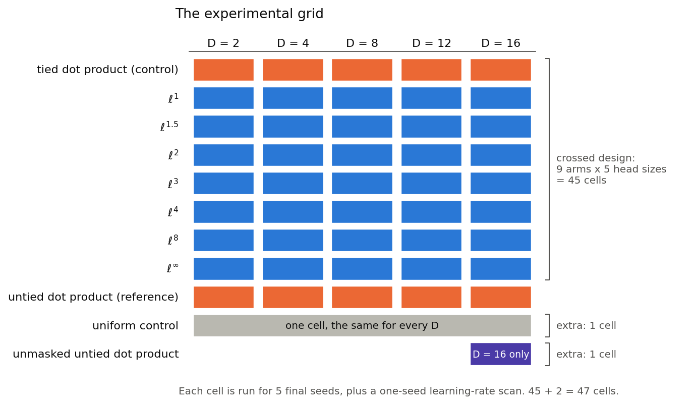
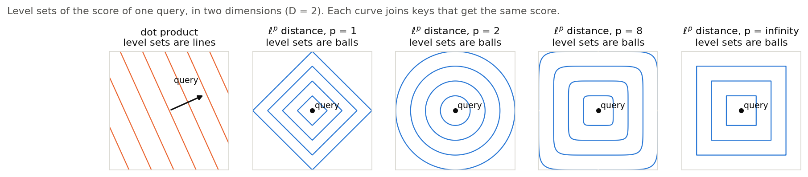
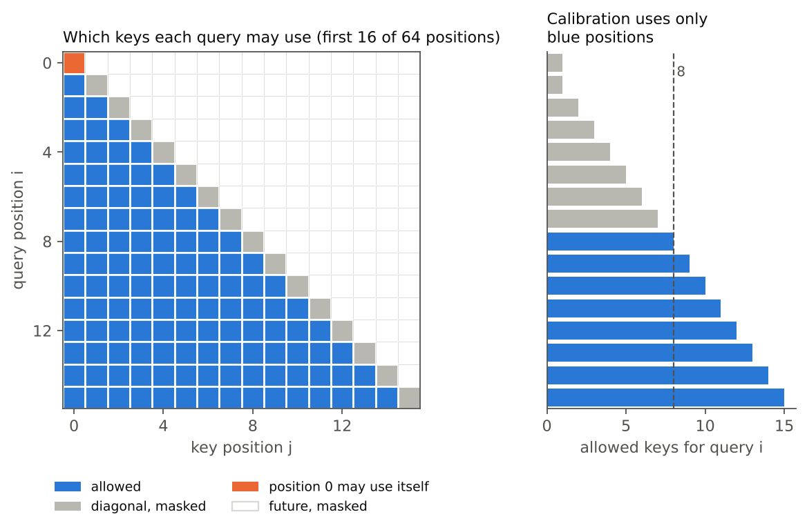
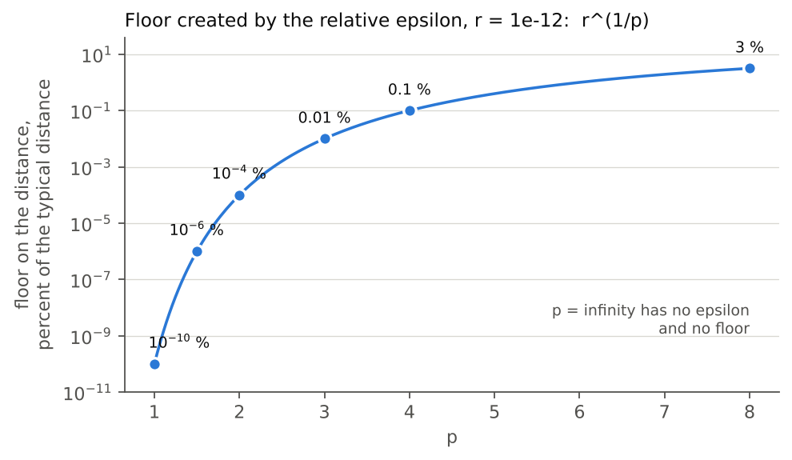
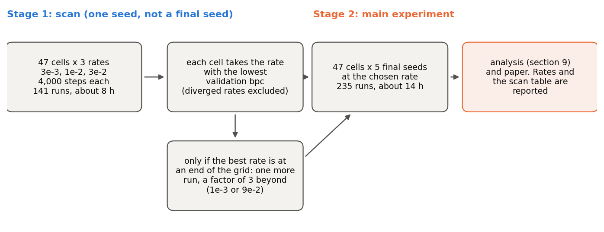

# Metric self-attention: design details

This is the second of two documents. Read `project_outline.md` first. It gives the question, the background and the motivation. This document gives the design in full: what is run, how each arm is defined, how the scores are scaled, how the runs are tuned, and how the results will be analysed. It is written for a reader who knows transformers and the usual training vocabulary, but has not seen this project.

Equations are written in LaTeX. Figures are drawn by `docs/figures/make_figures.py` from the formulas and tables in this document, and they contain no experimental results.

**Contents.**
1. Status
2. The experiment at a glance
3. The model, the data and the training
4. The arms and their scores
5. Masking the diagonal
6. Calibration of the score scale
7. The epsilon, the gradient and the p = 2 kernel
8. The learning-rate protocol
9. The statistical plan
10. What the write-up must state
11. History of the design
12. Decision record

## 1. Status

The design is settled. The code is written and the full run has finished. `results_guide.md` is the record of the run. This document is kept as it was before the run, so its estimates of cost and noise are not the measured values. The code is written against `implementation_plan.md`. One detail is deferred: the equivalence margin of test 6 in section 9. It is needed only if the write-up claims that two arms are equivalent. All other points were confirmed by the user, and section 12 lists them.

Nothing is run until the user agrees. Smoke tests of a few steps are the only exception, and they are part of writing the code.

## 2. The experiment at a glance

The project compares ways of scoring a query against a key inside self-attention. Each way is called an **arm**. The head size D is the length of the query and key vectors in each head. The experiment crosses the arms with five values of D.

- The nine **crossed arms** are the tied dot product (the control), seven L^p distances with p in {1, 1.5, 2, 3, 4, 8, infinity}, and the untied dot product (a reference).
- Two **extra arms** are not crossed with D. The **uniform control** gives every allowed key the same weight. The **unmasked untied dot product** is the standard transformer score without the diagonal mask, and it is run at D = 16 only.
- The head sizes are D = 2, 4, 8, 12 and 16.

A **cell** is one combination of an arm and a head size. The crossed arms give 9 x 5 = 45 cells. The uniform control does not depend on D, so it is one cell. The unmasked untied dot product is one cell at D = 16. That makes 47 cells in all.

A **run** is one training of one model for 4,000 optimiser steps. The outcome of a run is the validation bits per character (bpc) at the end. Every cell is run for five final seeds. A one-seed learning-rate scan comes first, and section 8 describes it. The scan takes 141 runs, and the main experiment takes 47 x 5 = 235 runs. Cells whose best scan rate lies at the end of the grid get one extra scan run each. The total cost is about 23 to 24 hours on the user's laptop, with an uncertainty of 30 to 40 percent. The budget is about 48 hours.

The analysis looks at the whole surface of validation bpc over D and p. Section 9 describes it.

## 3. The model, the data and the training

**The data.** The corpus is Tiny Shakespeare, a text of 1,115,394 characters. The model reads characters, and the vocabulary has about 65 symbols. The text is split 90/10 into training and validation parts. The outcome is validation bpc, which is the validation cross-entropy in nats divided by ln 2. Lower is better.

**The model.** It is a decoder-only transformer with pre-normalisation. It has two layers, a width of 64, four heads per layer, an MLP of width 4 x 64 with GELU, and a context of 64 characters. Positions are learned absolute embeddings. The input and output embeddings are tied. The context and the architecture are the same for every arm.

**What varies with D.** Only the query and key dimension of each head changes. A head projects the 64-dimensional layer input to D dimensions for the query and key. The value width stays at 16 per head, so four heads still add up to the width of 64. The rest of the model is unchanged. The smallest head, D = 2, has a query and key space with only two coordinates.

**Seeds and pairing.** A seed fixes the data stream and the initial values of all parameters that the arms have in common. Arms run with the same seed therefore start from the same point and see the same batches, so that differences between arms are paired. There are five final seeds. The learning-rate scan uses a sixth seed that is not one of the five.

**Training length.** Each run takes 4,000 optimiser steps.

**What is left to coding time.** The optimiser, the schedule, the batch size, the gradient clipping and the evaluation were fixed with the implementation plan, in section 6 of `implementation_plan.md`. The values are the same for every arm, and the learning-rate scan tunes only the peak rate.

**What is logged.** Each run logs the learned scale of each head, the largest logit, the attention entropy, and the norms of the queries and keys.

**Implementation requirements.**
- The L^p distance is a custom autograd function. The forward pass works in chunks and saves only the queries, the keys and the output. The backward pass recomputes the coordinate differences chunk by chunk. A plain version is kept in float64 as a reference test.
- The distances are computed in float32.
- All checks, benchmarks and runs are callable from one execute script. The code is Python scripts and not notebooks.
- The final weights of every run are saved and committed to git. Training checkpoints are not committed.
- The runs are made on the user's laptop, a 2020 Intel MacBook. The pinned environment is in `requirements.txt` (torch 2.2.2, numpy below 2).

## 4. The arms and their scores

**Attention.** Let $u_i$ be the normalised layer input at position $i$. A head turns the scores $s_{ij}$ of a query $i$ against its allowed keys $j$ into weights by a softmax, and it returns the weighted blend of the value vectors $v_j$:

$$a_{ij} = \frac{\exp(s_{ij})}{\sum_{j'} \exp(s_{ij'})}, \qquad o_i = \sum_j a_{ij}\, v_j .$$

The sums run over the allowed keys, which section 5 defines. Only the definition of $s_{ij}$ differs between the arms.

**Tied and untied projections.** In every arm except the untied dot product, the query and key come from one matrix, $z_i = W u_i$. This is called tying. In the untied dot product they come from two matrices, $q_i = W_Q u_i$ and $k_j = W_K u_j$. The untied arm therefore has one extra projection matrix per head.

**The scores.** Each head has a learned scale $\beta_h$ with initial value 1. A frozen constant $c$ is set by the calibration of section 6. The scores are

$$s_{ij} = \beta_h\, c\; z_i \cdot z_j \quad\text{(tied dot product)}, \qquad s_{ij} = \beta_h\, c\; q_i \cdot k_j \quad\text{(untied dot product)},$$

$$s_{ij} = -\,\beta_h\, c\; d_p(z_i, z_j) \quad\text{(L}^p\text{ arms)}.$$

The distance is

$$d_p(x, y) = \Big(\sum_{m=1}^{D} |x_m - y_m|^p + \varepsilon\Big)^{1/p} \quad (p < \infty), \qquad d_\infty(x, y) = \max_m |x_m - y_m| .$$

Here $\varepsilon$ is a small number that keeps the gradient finite, and section 7 defines it. The score is minus the distance and not its reciprocal. The distance is the plain distance with the root in every arm, including p = 2. The squared L^2 distance would equal the dot product plus a bias that depends only on the key, because the term depending only on the query cancels in the softmax. The plain L^2 distance has no such reduction, so the tied dot product and the L^2 arm are different controls.

**Geometry.** A dot product prefers the keys that lie furthest along the direction of the query. Its set of equal scores is a line, and its preferred region is a half-space. A distance prefers the keys nearest to the query, and its sets of equal scores are balls. The ball is a diamond for p = 1, a circle for p = 2, and a square for p = infinity. The outline gives the reasons why this difference may matter more at small D.

Two further points follow from the formula.
- The L^p distance with p other than 2 depends on the coordinate axes. A learned projection can choose its axes, so the model has some freedom to adapt. The dependence is accepted, and the write-up flags it.
- In two dimensions the L^1 and L^infinity balls are the same square up to a 45-degree rotation and a scale. The learned projection can supply the rotation. At D = 2 these two arms therefore have equal expressive power, and any difference between them reflects optimisation.

**The other arms.**
- The **untied dot product** measures what tying costs.
- The **unmasked untied dot product** is the standard transformer score with no diagonal mask. It measures how far the masked baseline departs from a standard model.
- The **uniform control** sets $a_{ij} = 1/n_i$, where $n_i$ is the number of allowed keys of query $i$. It has no score, so it has no scale and no calibration. It shows how much of the outcome attention can move at all. It is used as a descriptive scale and is not entered into any test.

## 5. Masking the diagonal

With tied projections, a position's query and its own key are the same vector $z_i$. The distance between them is exactly zero, which is the best score a distance can give. An unmasked position would then favour itself in every layer. For the tied dot product the self-score is $z_i \cdot z_i = \|z_i\|^2$. The Reformer paper (Kitaev, Kaiser and Levskaya, ICLR 2020, section 2) notes that this will almost always exceed the score with any other position.

That paper is the source of the masking rule and of its exception. A token may not attend to itself unless it has no other valid target, such as the first token. The project follows the rule. **Every query may use the keys of earlier positions. A query may not use its own key, except at position 0, which has no earlier position.** The causal mask hides later positions in every arm.

The Reformer argument covers only the dot product. The argument for the distance is the project's own geometric reasoning above. A second reason is calibration. The self-key would inflate the measured spread of scores and distort the starting scale. The cost of masking is small, because the residual connection already carries a position's own content to the next layer.

The rule applies to all arms of the language model, including the untied dot product, so that the comparison isolates the score function. The one exception is the unmasked untied dot product, which is run at D = 16 to measure the size of this departure from a standard model. The write-up states that the masking makes the dot-product baseline slightly non-standard.

## 6. Calibration of the score scale

Different score functions give different spreads of scores across the keys. The softmax is sensitive to that spread. An uncorrected comparison would partly measure how sharp each arm's attention happens to be at the start. Each arm therefore multiplies its raw score by a frozen constant $c$.

**The rule.** Let $r_{ij}$ be the raw score, which is the distance or the dot product before scaling. The constant is chosen so that the scaled scores of a query have a standard deviation of 1 across its allowed keys, at initialisation:

$$c = \frac{1}{\hat\sigma}, \qquad \hat\sigma = \text{standard deviation of } r_{ij} \text{ over the allowed keys, measured at initialisation.}$$

**The procedure.**
- The constant is measured once for each combination of arm, head size and layer. It is recomputed for every head size.
- The measurement uses a model built with a fixed calibration seed, run on fixed batches of text. All seeds share the result.
- It excludes the masked diagonal. It also excludes the early positions that have fewer than about 8 allowed keys, because a standard deviation over a handful of keys is unreliable. The right-hand panel of the mask figure in section 5 shows which positions remain.
- It proceeds layer by layer, so that each layer is measured on inputs produced by the layers below it.
- The unmasked untied dot product is the one arm whose allowed keys include the position itself. It is calibrated over all of its allowed keys, with the same rule on fewer than about 8 keys.
- How the standard deviations of single queries are pooled over positions, heads and batches is fixed in section 5 of `implementation_plan.md`.

**On top of the constant.** The learned scale $\beta_h$ starts at 1 for every arm. It lets the model sharpen or flatten its attention during training. Matching at initialisation is the whole scheme. The arms are not matched later in training, and the scale is not tuned per arm.

**Sanity check.** If the coordinates of $z$ have unit variance, then $z_i \cdot z_j$ has a standard deviation of $\sqrt{D}$, so the constant for the tied dot product should land near $1/\sqrt{D}$. This check is made on the measured constants.

**Limits.** The target of 1 is a convention. It gives soft but not flat attention at the start, and no other target has been tested. A single standard deviation is a crude summary of the score distribution. Distance scores are more skewed than dot-product scores, especially at large p, and the project accepts this.

## 7. The epsilon, the gradient and the p = 2 kernel

**Why an epsilon.** For a finite p above 1, the gradient of the distance with respect to the first vector is

$$\frac{\partial d_p}{\partial x_m} = \operatorname{sign}(x_m - y_m)\,|x_m - y_m|^{p-1}\; d_p^{\,1-p}.$$

When $x = y$ the distance is zero and the factor $d_p^{1-p}$ is infinite. The product is then undefined. Without a correction, the gradient fails at exact matches. Exact matches can occur, and training must not break when they do. A small number $\varepsilon$ added inside the root keeps the distance positive, and so keeps the gradient finite. The case p = 1 does not need it, because its gradient is the sign of the difference.

**A relative epsilon.** The value is $\varepsilon = r \, S_{\text{typ}}$. Here $S_{\text{typ}}$ is the typical size of the sum $\sum_m |x_m - y_m|^p$ for that arm, layer and head size, measured at initialisation and then frozen. The ratio is $r = 10^{-12}$. The earlier work found that $r = 0$ fails, that $r = 10^{-12}$ is safe in float32, and that larger values distort the metric for large p.

**The floor.** The epsilon puts a floor under the distance. The smallest possible distance is $\varepsilon^{1/p}$, which is the fraction $r^{1/p}$ of the typical distance $S_{\text{typ}}^{1/p}$. The floor is largest for large p. It is about 3 percent at p = 8, 0.1 percent at p = 4, 0.01 percent at p = 3 and 0.0001 percent at p = 2. It is smaller for the other finite values of p.

**p = infinity.** The distance is the largest coordinate difference, computed by a maximum. It has no epsilon and no floor. The gradient goes to the coordinate that attains the maximum, and it is split evenly among coordinates that tie. The gradients are sparse, and the project accepts this as inherent to the metric.

**The p = 2 kernel.** The L^2 distance is computed from the coordinate differences, like every other p. A faster formula exists, which expands $\|x - y\|^2 = \|x\|^2 + \|y\|^2 - 2\,x \cdot y$ and uses a matrix product. It subtracts large numbers that nearly cancel when two vectors are close, and the earlier work found that it lost accuracy at small distances. The project does not use it. The direct computation makes the L^2 arm about three times more expensive than the expansion would. The cost estimates already include this.

## 8. The learning-rate protocol

The earlier work found that the best learning rate can depend on the head size and on the arm. The dot-product arm needed a far higher rate at small D, and a shared low rate gave the false impression that distance was better. A shared rate can therefore manufacture a difference between arms. The protocol tunes the rate for every cell, in two stages.

**Stage 1, the scan.** Every one of the 47 cells is run once at each of the rates 3e-3, 1e-2 and 3e-2, for the full 4,000 steps. The scan seed is not one of the five final seeds. Each cell takes the rate with the lowest validation bpc. If that rate is at either end of the grid, the cell is run at one more rate, a factor of 3 beyond the grid, which is 1e-3 or 9e-2. A run that diverges at a rate is reported as a finding, and that rate is not chosen.

**Stage 2, the main experiment.** Each cell is run for the five final seeds at its chosen rate.

**Properties.**
- The protocol is fixed in advance. The scan is part of the experiment, and its results are reported.
- One seed has noise of about 0.01 bpc. Where two neighbouring rates differ by less than that, the choice is arbitrary but harmless, because the loss is flat there.
- The cost is about 8 hours for the scan and about 14 hours for the main runs on the laptop. The total is about 23 to 24 hours with the extra arms. These are estimates with an uncertainty of 30 to 40 percent.

**What the write-up must say.** The rate of each arm was tuned, so the arms differ in more than the score function. The rate was chosen on the validation set that the results are reported on. The chosen rates and the full scan table go in the write-up.

## 9. The statistical plan

**Notation.** Let $y_{s,D,a}$ be the validation bpc of seed $s$ (one of five), head size $D$ and arm $a$. The seed is a block. Within a seed, all cells share the data stream and the initial values of the common parameters, so comparisons are paired. The L^p arms are placed on the axis $1/p$, with the values 1, 0.67, 0.5, 0.33, 0.25, 0.125 and 0 for p = infinity. The two dot-product arms are references and lie off this axis. The **gap** of an L^p arm to the tied dot product is

$$g_{s,D,p} = y_{s,D,p} - y_{s,D,\text{tied dot}} .$$

A negative gap means that the distance arm is better. The outline's hypothesis predicts gaps that are most negative at small D and rise towards zero as D grows.

**The six analyses.**

| Test | Question | Quantity and method | Role |
|---|---|---|---|
| 1 | Does the effect of p depend on D? | Mixed model $y = \mu + \alpha_D + \gamma_p + (\alpha\gamma)_{D,p} + u_s + e$ with the seed as a random effect. F-test of the D x p interaction. | Primary |
| 2 | How large is the gap in each cell? | Paired gap $g$ with a confidence interval, for each L^p arm at each D. Holm correction within each D, over the family of seven arms. | Secondary |
| 3 | Does the gap change with D? | For each seed and arm, the slope of $g$ on $\log D$. One-sample t-test on the five slopes of each arm. The same test on the gap averaged over the seven arms. | Primary |
| 4 | What is the shape of the effect of p, and does it change with D? | At each D, linear and quadratic contrasts of the bpc across the axis $1/p$. Then the slope of each contrast on $\log D$. | Secondary |
| 5 | Which p is best? | Bootstrap over seeds, resampling whole seeds. For each D, the probability that each p has the lowest mean bpc, and the stability of the ranking across D. | Secondary |
| 6 | Are two arms equivalent? | Two one-sided tests (TOST) against a margin $\delta$. | Only if needed |

**Details.**
- In test 1, D and p enter as categorical factors. The interaction then has $4 \times 6 = 24$ degrees of freedom in the numerator.
- In test 3, each arm has one slope per seed, so each t-test uses five slopes and four degrees of freedom.
- In test 5, five seeds allow only 126 distinct resamples, so the probabilities are coarse. They are reported as rough guides.
- Test 6 is run only if the write-up claims that two arms are equivalent. The margin $\delta$ is chosen then, after the noise has been re-measured.
- Gaps outside the Holm family, such as the gap of the untied to the tied dot product, are given as uncorrected intervals and are labelled as such.
- The uniform control and the two untied arms are not entered into any test. The write-up reports the uniform control's bpc beside the other arms as a qualitative scale.
- The write-up reports each seed's paired difference next to every summary.

**Caveats.** There are only five seeds. The mixed model assumes approximately normal residuals. The spread of bpc may differ across D. The noise level of about 0.01 bpc comes from the earlier version, at a different length, and will be re-measured in the main runs. With that noise and five seeds, a difference smaller than roughly 0.02 bpc cannot be detected. The outline's limitations section gives the figure.

## 10. What the write-up must state

Each item restates a decision above.
- The scale of the score was not tuned per arm, and the target spread of 1 was chosen by convention (section 6).
- The diagonal masking departs from a standard language model, so the dot-product baseline is slightly non-standard (section 5).
- The epsilon puts a floor under the distance. The floor is about 3 percent at p = 8 (section 7).
- The learning rate was tuned for each arm and each head size, and it was chosen on the validation set that the results are reported on (section 8).
- The untied arm has one extra projection matrix per head (section 4).
- The L^p distances with p other than 2 depend on the coordinate axes. This is accepted and flagged (section 4).
- The conclusions rest on learned absolute position embeddings. Section 7 of the outline lists a relative-position run as a possible later check.
- Any arm that diverges is reported as a finding about that metric and is not hidden.

## 11. History of the design

These paragraphs record earlier decisions that shaped the present design. The first version of the project, including its code and pilot, is kept in `shelved/` as a record and is not part of the live project.

**Head-size grid.** The grid of head sizes is D = 2, 4, 8, 12 and 16. The user added D = 8 and D = 12 to the earlier first round of D = 2 and 4 beside the default D = 16. D = 1 is skipped, because all L^p arms coincide there.

**Shelving of the recall task.** The user shelved the recall task (MQAR) because the distance arms sit at its accuracy ceiling and the dot-product result depends on the learning rate, and because further pilots on it would not end. The code, the design decisions and the pilot findings were moved into `shelved/pilot_v1/mqar/`, with its own entry point and tests. The main engine was made task-agnostic so that the task plugs in. The language model is run by itself first. The full results then decide whether the recall task is needed.

**Restart from scratch.** The user shelved all of the version 1 code, including the language-model code, the pilot report and the pilot results, in `shelved/pilot_v1/`. The project is being rebuilt from scratch against the outline and these details. Two implementation choices of version 1 had not been approved by the user, namely r = 10^-12 and the direct p = 2 kernel. The user approved both on the same day. The grid of nine arms was confirmed on that day too.

## 12. Decision record

All decisions below were confirmed by the user, and the last review was on 2026-10-05.

| Decision | Value | Section |
|---|---|---|
| Question | How head size D and the choice of p interact, studied on the language model alone | outline |
| Crossed arms | Tied dot product (control), L^p with p = 1, 1.5, 2, 3, 4, 8, infinity, untied dot product (reference) | 2, 4 |
| Extra arms | Uniform control (a full arm, one cell, five seeds); unmasked untied dot product at D = 16 only | 2, 4 |
| Head sizes | D = 2, 4, 8, 12, 16. Only the query and key dimension changes. The value width stays 16 per head. | 3 |
| Tying | Queries and keys tied in every arm except the untied reference | 4 |
| Score | Minus the distance, scaled by a learned factor per head (initial value 1) and a frozen calibrated constant | 4, 6 |
| Calibration | Target standard deviation 1 across allowed keys at initialisation, per head size, arm and layer. The unmasked arm is calibrated over all its allowed keys. | 6 |
| Masking | Diagonal masked in all arms except the unmasked reference. Position 0 may attend to itself. | 5 |
| Epsilon | Relative, $r = 10^{-12}$. No epsilon at p = infinity. | 7 |
| p = 2 kernel | Direct coordinate differences, not the matrix-product expansion | 7 |
| Normalisation | No normalisation of queries and keys | 4 |
| Position encoding | Learned absolute positions | 3 |
| Model | Two layers, width 64, four heads, MLP 4x, context 64, tied embeddings | 3 |
| Data and outcome | Tiny Shakespeare, 90/10 split, validation bpc | 3 |
| Training length | 4,000 steps per run | 3 |
| Learning rates | One-seed scan at 3e-3, 1e-2, 3e-2 for every cell, one extra rate at an end, then the main runs at the chosen rate | 8 |
| Seeds | Five final seeds per cell, plus a scan seed | 3 |
| Compute | The user's laptop. Final weights committed to git. | 3 |
| Statistical plan | Tests 1 and 3 primary. Tests 2, 4, 5 secondary. Test 6 only if needed, margin deferred. No permutation tests. The uniform control is a descriptive scale only. | 9 |
| Recall task | Shelved | 11 |
